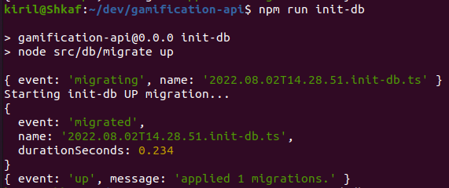
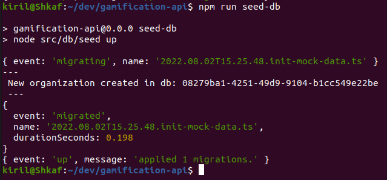

# gamification-api
API supporting the Gamification project at Topcoder.

## Quick Start
Assuming you have PostgreSQL server running locally and the database `tc_gamification` exists. If this is not the case, either install PostgreSQL server or use the docker-compose provided. See "Docker support" section how to do that.

When PostgreSQL server is ready, proceed with the commands below to get started. Following steps require working db connection, take care to setup the URL properly and with correct credentials.

1. `npm i`
2. Setup local env vars - execute is terminal:

```sh
export POSTGRE_SQL_USER=<PG_USER>
export POSTGRE_SQL_PASS=<PG_PASS>
export POSTGRE_SQL_DATABASE=<HOST&DB_NAME>
```

3. `npm run init-db`
4. `npm run seed-db` - optional step, assuming you want mock data for development.
5. Set the local environment file - we keep a sample file with all vars one needs to have set to be able to run the API locally. Check the `.env.development.local.sample`, fill it with proper values, and finally rename it to `.env.development.local`. Done, vars will be picked-up on server start.
6. `npm run dev`

## Docker support
WIP

## Migrations & Seeds
This project is using [Umzug](https://www.npmjs.com/package/umzug) for running and rolling back tasks relted to db model migrations. The database could be programmatically modified throughout the life of the project so that the current state of the design can be arrived at by executing a series of migration scripts or calls.

We are writing migrations/seed in TypeScript. See `./src/db` folder for more details. There are `migrate.js` & `seed.js` files which can be executed via node.js in terminal. Those file implement the Umzug API. As you may find, `npm init-db` and `seed-db` are proxy calls to Umzug.

For detailed info how to write migrations in TypeScript with Umzug see its documentation: https://github.com/sequelize/umzug#migrations

There is an example of our initial migration in the `src/db/migrations/2022.08.02T14.28.51.init-db.ts` file.

Here, what the migration does is:
- Reads our SQL file with schema create statements and executes those via the `.query(...SQL)` [API from Sequelize](https://sequelize.org/docs/v6/core-concepts/raw-queries/).
- the `down` migration would drop all tables in the daatabase and restore to initial state if executed.

After completion it should look similar to:



For seeds, check the initial seeder as example: `src/db/seeders/2022.08.02T15.25.48.init-mock-data.ts`
- for `up` it creates data in the tables
- for `down` truncates the tables

After completion it should look similar to:



__Note:__ here you get the `ORG_ID` which is needed later for requests to the API.
### How to sync db models used by the Sequelize ORM with latest db structure?
When changes/migrations affect the database schema structure the ORM models need to reflect and update accordingly. We use an automated approach to solve this need. There is a tool in npm, named [sequelize-auto](https://www.npmjs.com/package/sequelize-auto) which is installed as a dev dependency.

In project root type:

`npm run sync-orm`

This command will execute and update the typescript files in the `src/db/models` folder. Those are the ORM definitions used by Sequelize. Note that `sequelize-auto` has some issues and leaves unused variables defined. This could cause lint errors. Therefore we run `sequelize-auto` and after it we run `npm run lint:fix` for convenience but still you may need to do small work to clean up the generated code.

## Assets Hosting
Badge images and asstest are hosted on [AWS S3](https://s3.console.aws.amazon.com/s3/buckets/tc-gamification?region=us-east-1&tab=objects).

On PROD & DEV the bucket name is the same - `tc_gamification`.

We follow strict naming convention: `org_id/badge_image_id.file_ext`. This will ensure badge images are stored in folders per organization and are uniqie named.

This is public access bucket, which provides access to the digital assets used by the gamification project. All files are served with proper HTTP headers. We set `CacheControl: 'max-age=31536000'` (365 days)  header to all badge images which ensures speed loading and reduces traffic.

## Keycloak validation branch

`keycloak_m2M` pins shared core `4.0.0-keycloak.0` at
`c262f4aca971904f308085bdeaaed35cdf3cfa7d`. Before rollout configure
`M2M_PROVIDER=keycloak`, `KEYCLOAK_ISSUER`, `KEYCLOAK_AUDIENCE`, and the managed
HTTPS `KEYCLOAK_TOKEN_URL`. This API does not issue M2M tokens, so no client
secret is needed. Protected badge operations remain member-administrator only;
verified service tokens receive 403. Invalid/missing credentials receive 401
in the existing v3 error envelope. Public badge reads remain public.

Configure member trust with `VALID_ISSUERS` as a JSON array, `AUTH_SECRET` for
HMAC tokens, and `AUTH_USER_AUDIENCES` as a JSON array or explicit
`ALLOW_LEGACY_USER_AUDIENCE=true`. Shared core handles exact issuer/audience,
algorithm, lifetime and normalized claims. Members need a positive user ID and
verified handle for badge audit attribution; nickname/name fallbacks are removed.
Member scope claims do not create permissions. Existing role checks remain.

Run `nvm use`, `npm run lint`, `npm run build`, and `npm test`. No application
is deployed and this branch must remain outside deployment branch filters.
